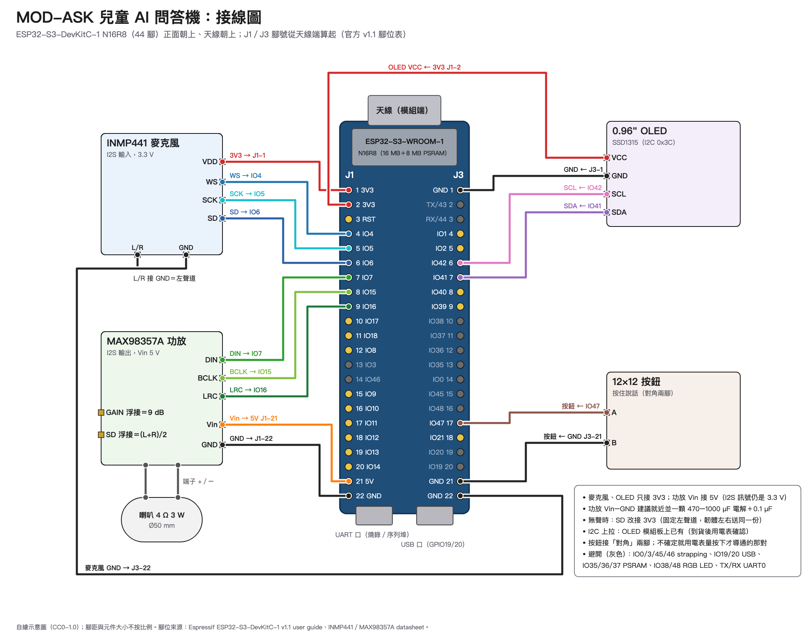
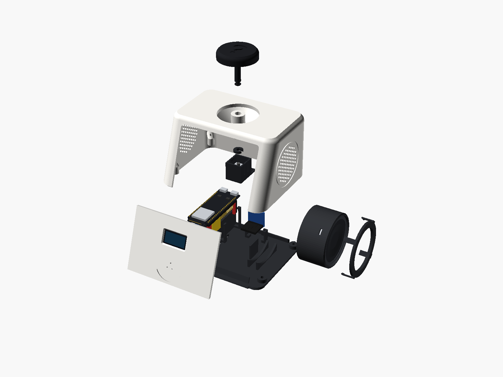

# MOD-ASK 兒童 AI 問答機（ESP32-S3 按住說話）

> **狀態：尚未實機驗證。** 目前完成的是設計、韌體編譯、電腦上的單元測試與文件；還沒有燒錄到實機、沒有量過延遲，外殼也還沒印出。請把這裡的一切當成「設計稿＋可編譯的程式」。

按住大圓鈕說話，放開後 ESP32-S3 用 Wi‑Fi 把錄音傳到**你自己的伺服器**；伺服器做語音辨識 → AI 回答 → 語音合成，回傳語音由喇叭播放。OLED 顯示「待機／聆聽中／思考中／回答中／錯誤」。兒童內容規則與提問紀錄都放在伺服器端。

```
按住 ─► ESP32-S3 錄音 ──HTTPS POST WAV──► 你的伺服器：STT → 兒童規則 → LLM → 兒童規則 → TTS
放開 ◄── MAX98357A 播放 ◄──── WAV（邊收邊播）────┘        （server/ 是最小參考實作）
```

- 預期延遲 **2–4 秒**（估計，未實測）。
- 伺服器網址**預設空白**、可設定；不連任何第三方雲端。文件裡的網址一律是佔位 `https://ai.example.com`。

## 目錄

| 路徑 | 內容 |
|---|---|
| `firmware/` | Arduino-ESP32 韌體（按住說話、I2S 錄放、OLED、HTTPS）＋主機端單元測試 |
| `server/` | 最小參考伺服器（Python 標準函式庫；STT／LLM／TTS 可替換，預設假引擎） |
| `docs/` | 協議 `SERVER_API.md`、架構、建置與燒錄、韌體選擇、xiaozhi 選配、[製作紀錄 `JOURNAL.md`](docs/JOURNAL.md)、[維護流程 `MAINTAINING.md`](docs/MAINTAINING.md) |
| `wiring/` | 腳位表（md＋csv）、接線圖（SVG＋PNG） |
| `cad/` | 外殼 OpenSCAD 原始檔、STL、算繪圖、GLB、列印順序（STEP 與 G‑code 太大，附在 [Release v0.1.0](https://github.com/h2ocloud/mod-ask-kids-ai/releases/tag/v0.1.0)） |
| `bom/` | 材料表（md＋csv，不含價格與通路） |

## 材料（BOM 摘要）

ESP32-S3-DevKitC-1 **N16R8**、INMP441 麥克風、MAX98357A 功放＋4 Ω 3 W Ø50 喇叭、0.96" I2C OLED（SSD1315）、12×12 按鍵＋大帽、杜邦線約 20 條、M3 螺絲、腳墊、泡棉。完整表：[`bom/BOM.md`](bom/BOM.md)。

## 接線



| 模組 | 腳 → ESP32-S3（排針） |
|---|---|
| INMP441 | VDD→3V3（J1-1）、GND→J3-22、L/R→GND、WS→GPIO4（J1-4）、SCK→GPIO5（J1-5）、SD→GPIO6（J1-6） |
| MAX98357A | Vin→**5V**（J1-21）、GND→J1-22、DIN→GPIO7（J1-7）、BCLK→GPIO15（J1-8）、LRC→GPIO16（J1-9）；GAIN、SD 不接 |
| OLED | VCC→3V3（J1-2）、GND→J3-1、SCL→GPIO42（J3-6）、SDA→GPIO41（J3-7） |
| 按鍵 | 一腳→GPIO47（J3-17）、對角另一腳→GND（J3-21） |

- 避開：GPIO0/3/45/46（strapping）、19/20（USB）、35/36/37（Octal PSRAM）、38/48（RGB LED）、43/44（UART0）。
- 麥克風與 OLED 只接 3V3；功放 Vin 建議並 470–1000 µF 電容。
- 完整說明、電源與官方來源：[`wiring/PINMAP.md`](wiring/PINMAP.md)。

## 3D 列印



- Creality Ender-3（0.4 mm 噴嘴）、PLA（只有黑、白）、Cura 5.6「Low 0.28」、2 道牆、**免支撐**；第 1–3 層關風扇、第 4 層起全速。
- **和姊妹專案 [Wi‑Fi 偵測節點](https://github.com/h2ocloud/esp32c3-wifi-sensing-node) 一起排成兩盤**：先印 **白盤**（問答機上殼、前面板＋Wi‑Fi 節點滑蓋，約 10 h、90 g），再印 **黑盤**（問答機底座、大圓鈕、開關座、卡圈、墊片、壓條、喇叭後腔與壓環＋Wi‑Fi 節點殼身與小件，約 11.4 h、100 g）。兩盤合計約 21.5 h、190 g（切片軟體估計，**尚未實際印出**）。
- 為什麼先白後黑：上殼最大、最高、最容易翹，也是唯一不能靠泡棉或墊片補救的件，先印先發現問題；黑盤的件要和上殼一起才試得了配合。
- 只印問答機：用 `cad/stl/plate/ASK_WHITE.stl`、`ASK_BLACK.stl` 自己切片。
- 完整列印順序與每盤印完的合格檢查（白盤 9 項、黑盤 8 項）：[`cad/PRINT_ORDER.md`](cad/PRINT_ORDER.md)。
- 3D 文件：<!-- ONSHAPE -->[Onshape 公開文件（R2 零件工作室）](https://cad.onshape.com/documents/26e2bdcd8b8449438ee7556c/w/0d064837454aeb55c035dda0/e/d83a137c4711ee4c535cc761)（同一份文件裡還有 [R1 工作室](https://cad.onshape.com/documents/26e2bdcd8b8449438ee7556c/w/0d064837454aeb55c035dda0/e/0ed907cfb3682001e2f4daf6)）<!-- /ONSHAPE -->
- 零件尺寸多為典型值，外殼每個卡位都留了 ±1 mm 調整空間（泡棉、墊片、長孔）；到貨後怎麼調見 [`cad/README.md`](cad/README.md)。
- [Release v0.1.0](https://github.com/h2ocloud/mod-ask-kids-ai/releases/tag/v0.1.0) 附：STL 壓縮檔、**STEP**（R2，壓縮檔）、兩盤 **G‑code**（`1_WHITE_ask_wifi.gcode`、`2_BLACK_ask_wifi.gcode`）。G‑code 是作者那台 Ender‑3 的版本（含兩個模組的件、該機專屬的起始碼與擺位），**別台印表機請用 STL 自己切片**。

## 韌體

```sh
sh firmware/build.sh --setup                          # 一次：裝 esp32 core 3.3.12 與 U8g2 2.36.19（使用者層，不用 sudo）
cp firmware/mod_ask/secrets.example.h firmware/mod_ask/secrets.h   # 填 Wi-Fi 與你的伺服器網址（不要 commit）
sh firmware/build.sh                                  # 編譯
PORT=/dev/cu.usbserial-XXXX sh firmware/build.sh --upload   # 燒錄（插板子的 UART 口）
sh firmware/test/run_tests.sh                         # 主機端單元測試（clang + ASan/UBSan）
```

- FQBN：`esp32:esp32:esp32s3:FlashSize=16M,PSRAM=opi,PartitionScheme=app3M_fat9M_16MB`。
- 沒有 `secrets.h` 也能編譯：開機顯示「尚未設定」，不連網。
- 詳細步驟與到貨後檢查：[`docs/BUILD_FLASH.md`](docs/BUILD_FLASH.md)；為什麼自製而不用 xiaozhi-esp32：[`docs/FIRMWARE_CHOICE.md`](docs/FIRMWARE_CHOICE.md)。

## 伺服器

- 協議：[`docs/SERVER_API.md`](docs/SERVER_API.md)（`GET /v1/health`、`POST /v1/ask`；WAV 進、WAV 出）。
- 參考實作：[`server/README.md`](server/README.md)。預設只綁 `127.0.0.1`、用假引擎；正式使用請放在 HTTPS 反向代理後面，金鑰只放環境變數。

## 限制（請先讀）

- 一定要網路與伺服器；伺服器停了，問答機只會顯示錯誤。
- 延遲 2–4 秒是估計值，依伺服器與網路而定。
- **內容安全靠伺服器規則**，參考伺服器的關鍵字過濾是粗篩，會誤擋也會漏掉；不能取代大人陪伴與 AI 供應商的安全機制。
- 只支援 2.4 GHz Wi‑Fi；沒有回音消除、沒有喚醒詞、沒有 OTA、沒有電池。
- SSD1315 與 SSD1306 命令相容是社群慣例，沒有原廠一手聲明，到貨後實測。

## 兒童使用安全

- 殼內有螺絲與小零件，**3 歲以下不適用**；組裝後鎖緊螺絲、貼好腳墊。
- 音量預設 60、上限 80（`firmware/mod_ask/config.h`）；不要貼著耳朵。
- 裝置不收集個資（裝置 ID 是亂數、不傳 MAC／SSID／位置）；伺服器預設不存錄音、提問紀錄可設保留天數或關閉。
- 只用 USB 5 V；PLA 約 55–60 °C 會軟化，不要放窗邊、暖爐旁或車內。

## 製作紀錄

這個專案像接力賽一樣由很多角色（產品、採購、接線、機構、切片、韌體、軟體、AI）一棒一棒做出來，每一步做了什麼、哪裡失敗、怎麼修都記在 [`docs/JOURNAL.md`](docs/JOURNAL.md)。零件到貨、外殼印出後會繼續補記。

## 授權

| 部分 | 授權 |
|---|---|
| 韌體、參考伺服器、工具程式 | MIT |
| 外殼、接線說明、BOM | CERN-OHL-P-2.0 |
| 接線圖（自繪） | CC0-1.0 |
| OLED 中文字點陣 `labels_zh.h` | OFL-1.1（由 Cubic 11 算繪） |

沒有任何相依強制 GPL，所以韌體維持 MIT。細節見 [`LICENSE`](LICENSE)、[`NOTICE`](NOTICE)、[`LICENSES/`](LICENSES/)。

## 致謝與上游

- [Arduino-ESP32](https://github.com/espressif/arduino-esp32)（Espressif）、[U8g2](https://github.com/olikraus/u8g2)（olikraus）
- [Cubic 11 俐方體11號](https://github.com/ACh-K/Cubic-11)（OLED 中文字點陣）
- [xiaozhi-esp32](https://github.com/78/xiaozhi-esp32)：本專案接線與其 `bread-compact-wifi` 板型相容，可當選配韌體（[`docs/XIAOZHI_OPTION.md`](docs/XIAOZHI_OPTION.md)）
- 規格資料：Espressif、TDK、Analog Devices（Maxim）、Solomon Systech、Omron 官方文件（清單見 `wiring/PINMAP.md`）

---

## English summary

**MOD-ASK** is a push-to-talk "ask me anything" box for kids, built on an **ESP32-S3-DevKitC-1 N16R8** with an INMP441 I2S microphone, a MAX98357A I2S amplifier with a 4 Ω 3 W speaker, a 0.96" I2C OLED (SSD1315) and a big 12×12 push button. Hold the button and talk; on release the device uploads a 16 kHz WAV over HTTPS to **your own server**, which runs STT → LLM → TTS and streams a WAV answer back. Child-safety rules, quotas and the (optional, text-only) question log live on the server.

- **Status: not yet tested on real hardware.** Firmware compiles (Arduino-ESP32 3.3.12, 0 warnings); pure-logic modules pass 19 host-side unit tests (573 checks, ASan/UBSan, mutation-tested); the reference server passes 264 unit tests. Parts arrive later.
- The server URL is configurable and **empty by default** (no third-party cloud). Protocol: `docs/SERVER_API.md`. Reference server (Python stdlib, fake engines by default): `server/`.
- Wiring: `wiring/PINMAP.md` (cross-checked against Espressif's official DevKitC-1 docs and datasheets). Pin-compatible with xiaozhi-esp32's `bread-compact-wifi` board.
- Enclosure: OpenSCAD sources, STL, renders and GLB in `cad/`; PLA, no supports. It is printed on two plates (white, then black) together with the sister project [esp32c3-wifi-sensing-node](https://github.com/h2ocloud/esp32c3-wifi-sensing-node). STEP and the two G-code files (for the author's own Ender-3 only) are attached to Release v0.1.0. 3D document on Onshape (link above).
- Build log (in Chinese): `docs/JOURNAL.md`.
- Licenses: firmware/server/tools MIT; hardware (cad, wiring docs, BOM) CERN-OHL-P-2.0; wiring drawing CC0-1.0; OLED glyph bitmaps OFL-1.1.
