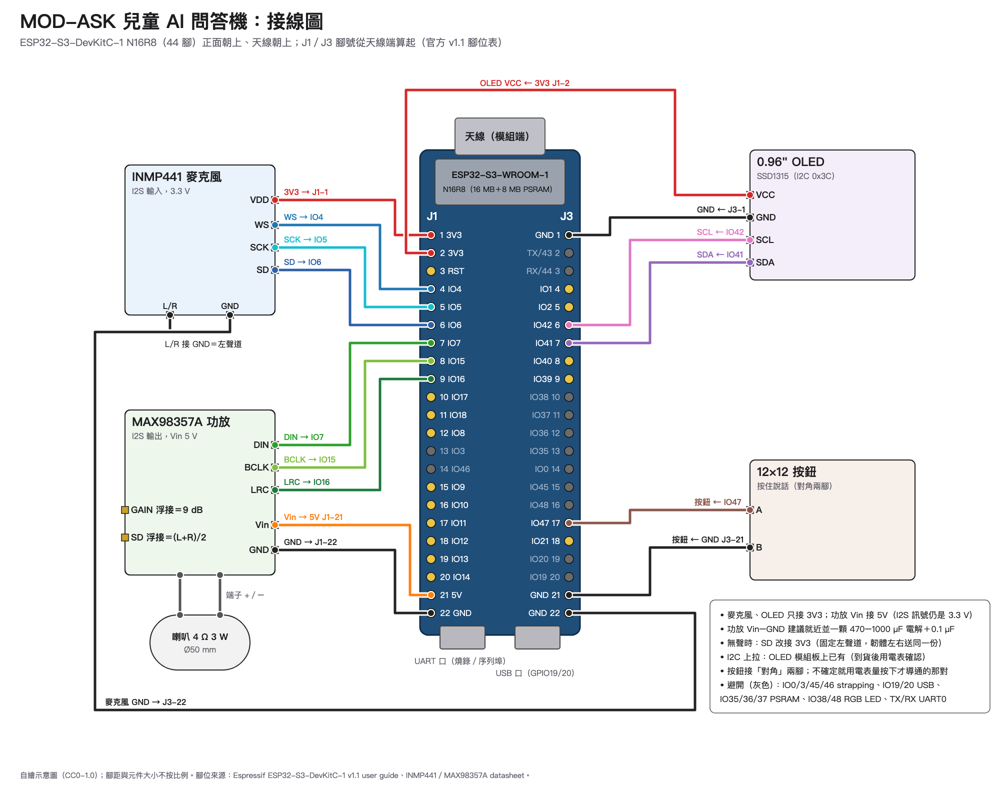

# MOD-ASK 腳位表與接線說明

> 狀態：**依官方文件交叉查證，尚未實機驗證**（零件到貨後要照「到貨後檢查」逐項確認）。

- 接線圖 `wiring_mod_ask.svg`／`.png` 為本專案自繪（CC0-1.0），不含第三方元件圖；產生程式在 `src/`。
- 板子正面（金屬殼模組那面）朝上、天線朝上看：左排是 **J1**、右排是 **J3**，**第 1 腳在天線端**（官方腳位圖與原理圖一致）。

## 1. 接線表

| # | 模組 | 模組腳 | 接到 ESP32-S3 | 排針位置 | 線色建議 | 說明 |
|---|---|---|---|---|---|---|
| 1 | INMP441 | VDD | 3V3 | J1-1 | 紅 | 只能 3.3 V（datasheet 上限 3.63 V） |
| 2 | INMP441 | GND | GND | J3-22 | 黑 | |
| 3 | INMP441 | L/R | GND | （模組上短接到 GND） | 黑 | 接 GND＝左聲道（WS 低電位那半框輸出） |
| 4 | INMP441 | WS | GPIO4 | J1-4 | 藍 | |
| 5 | INMP441 | SCK | GPIO5 | J1-5 | 青 | |
| 6 | INMP441 | SD | GPIO6 | J1-6 | 深藍 | 麥克風 → ESP32 |
| 7 | MAX98357A | Vin | 5V | J1-21 | 橘 | 5 V 才推得到約 3 W（見 §3） |
| 8 | MAX98357A | GND | GND | J1-22 | 黑 | |
| 9 | MAX98357A | DIN | GPIO7 | J1-7 | 綠 | ESP32 → 功放 |
| 10 | MAX98357A | BCLK | GPIO15 | J1-8 | 淺綠 | |
| 11 | MAX98357A | LRC | GPIO16 | J1-9 | 墨綠 | |
| 12 | MAX98357A | GAIN | 不接 | — | — | 浮接＝9 dB |
| 13 | MAX98357A | SD | 不接 | — | — | 浮接（模組上拉）＝(L+R)/2；無聲時改接 3V3（見 §3） |
| 14 | MAX98357A | 端子 ＋／− | 喇叭兩條線 | — | — | 4 Ω 3 W Ø50 mm |
| 15 | OLED | VCC | 3V3 | J1-2 | 紅 | **有些模組 VCC／GND 順序相反，依絲印接** |
| 16 | OLED | GND | GND | J3-1 | 黑 | |
| 17 | OLED | SCL | GPIO42 | J3-6 | 粉紅 | |
| 18 | OLED | SDA | GPIO41 | J3-7 | 紫 | |
| 19 | 按鈕 | 一腳 | GPIO47 | J3-17 | 棕 | 內部上拉，按下＝低電位 |
| 20 | 按鈕 | 對角另一腳 | GND | J3-21 | 黑 | |

共 16 條杜邦線接到開發板（每支排針只插一條），另有麥克風板上 L/R–GND 短接、喇叭兩條線。機器可讀版：`pins.csv`。

### 為什麼選這些腳
- 和開源專案 xiaozhi-esp32 的 `bread-compact-wifi` 板型腳位完全一致（麥克風 4/5/6、功放 7/15/16、OLED 41/42、按住說話 47），之後想改用那套韌體不必重新接線（見 `docs/FIRMWARE_CHOICE.md`）。
- 全部避開 strapping、USB、PSRAM、RGB LED、UART0（見 §2）。韌體 `config.h` 用 `static_assert` 擋住這些腳。

## 2. 不要用的腳

| 腳位 | 排針 | 原因 | 來源 |
|---|---|---|---|
| GPIO0、3、45、46 | J3-14、J1-13、J3-15、J1-14 | strapping：開機時決定開機模式、JTAG 來源、VDD_SPI 電壓（GPIO45 開機時被拉高會把 flash／PSRAM 電壓設成 1.8 V） | ESP32-S3 datasheet v2.2 Ch.3 |
| GPIO19、20 | J3-20、J3-19 | 原生 USB D−／D+（板上「USB」口） | 官方 user guide；ESP-IDF GPIO 文件 |
| GPIO35、36、37 | J3-13、J3-12、J3-11 | **N16R8 是 Octal PSRAM**，這三腳接 PSRAM，不能做其他用途 | WROOM-1 datasheet v1.8 p.12 註 b |
| GPIO38 | J3-10 | DevKitC-1 **v1.1** 的板載 RGB LED | v1.1 user guide |
| GPIO48 | J3-16 | DevKitC-1 **v1.0** 的板載 RGB LED（USB-C 相容板也常放這裡） | v1.0 user guide |
| GPIO43、44 | J3-2、J3-3 | UART0 TX／RX，接 USB 轉 UART 晶片（燒錄、序列埠 log） | 官方 user guide |

注意（可用但要知道）：
- **GPIO41／42** 是 JTAG 的 MTDI／MTMS。eFuse 預設 JTAG 走內建 USB，所以可當一般 GPIO；之後若要接外部 JTAG 除錯器會衝突。
- **GPIO15／16** 是 XTAL_32K_P／N。開發板上沒有 32 kHz 晶振、IDF 預設用內部 RC，所以可當一般 GPIO。
- **GPIO47** 在 VDD_SPI 電源域：N16R8（3.3 V flash／PSRAM）是 3.3 V，可以直接用。若實物其實是 `N32R16V` 這類 1.8 V 版，按鈕改接 **GPIO21（J3-18）** 並改 `config.h` 的 `PIN_BUTTON`。

## 3. 電源

| 項目 | 建議 | 理由與風險 |
|---|---|---|
| 整機供電 | USB 5 V（插板上的「UART」口；另一口也可以） | 官方：USB、5V 腳、3V3 腳三種供電擇一，不要同時 |
| 麥克風、OLED | **3V3** | ESP32-S3 GPIO 不耐 5 V；OLED 模組的 I2C 上拉接在 VCC 上，VCC 接 5 V 會把 SDA／SCL 拉到 5 V |
| 功放 Vin | **5V（J1-21）** | MAX98357A：VDD 2.5–5.5 V；5 V／4 Ω 典型 3.2 W（10% THD），3.3 V 時約 1.3 W。數位輸入 VIH ≥ 1.3 V，所以 Vin 接 5 V 時 3.3 V 的 I2S 訊號照樣相容 |
| 5V 腳實際電壓 | 約 4.6 V | 官方原理圖：USB VBUS 經蕭特基二極體（1 A，VF 0.32–0.45 V）到 5V 腳；官方文件沒有寫 5V 腳可以「輸出」，這是依原理圖推論 |
| 去耦電容（建議加） | 功放 Vin–GND 就近並 **470–1000 µF 電解＋0.1 µF 陶瓷** | 喇叭大聲時的瞬間電流會讓 USB 5 V 下陷，可能讓 ESP32 重開機（brownout）或 Wi‑Fi 斷線 |
| 音量上限 | 韌體預設 60、硬上限 80（`config.h`） | 保護小孩聽力，也壓低峰值電流；USB 2.0 埠只保證 500 mA |
| 功放 SD 腳 | 預設不接 | 模組上的上拉讓 SD 落在 (L+R)/2 區間（5 V 供電約 0.45 V）。若功放改用 3.3 V 供電，SD 約 0.30 V，可能低於關斷門檻上限 0.355 V → **無聲**；這時把 SD 直接接 3V3（固定左聲道），韌體左右送同一份資料，不影響音量 |

## 4. I2S 與 I2C 設定（韌體已處理）

- 麥克風：I2S0、標準 Philips、16 kHz、**32 bit 槽**（INMP441 規定每個 WS 週期 64 個 SCK；設 16 bit 槽不合規格）、單聲道左。24 bit 資料右移 14 位轉成 16 bit（`MIC_SHIFT`）。
- 功放：I2S1、16 bit、左右送同一份。**MAX98357A 只吃 8／16／32／44.1／48 kHz**；伺服器回 24／22.05 kHz 時韌體做 2 倍升頻、12／11.025 kHz 做 4 倍。
- OLED：I2C 400 kHz、位址 0x3C（少數模組 0x3D）。SSD1315 用 SSD1306 驅動（U8g2）。**SSD1315 與 SSD1306 命令相容沒有找到原廠一手聲明**，屬社群慣例，到貨後要實測。
- INMP441 datasheet 建議 SD 線加 100 kΩ 下拉；我們只讀左聲道，影響小，模組上有沒有要到貨後看。

## 5. 到貨後檢查（通電前）

1. **確認板型**：數一邊排針是 22 支（44 腳）、模組上印 `ESP32-S3-WROOM-1`、標籤有 `N16R8`。看 USB 口：官方 v1.0／v1.1 都是 **Micro-USB**；如果是 **USB-C**，多半是相容板（例如 YD-ESP32-S3），腳位大致相同但要對絲印，RGB LED 通常在 GPIO48（我們沒用到）。
2. **對絲印接線**，不要憑位置。特別是 OLED 的 VCC／GND 順序。
3. **按鈕**：12×12 輕觸開關四支腳兩兩相通（依 Omron B3F 規格是「隔著本體正對面」那兩支相通、同側相鄰兩支要按下才通）。**接對角兩支一定對**；不確定就用三用電表量「按下才導通」的那一對。
4. 三用電表：3V3 對 GND、5V 對 GND 都不該嗶；SDA、SCL 對 3V3 約 4.7–10 kΩ（模組上拉）。
5. 第一次通電先只接 USB、看序列埠 `[BOOT]` 訊息與 PSRAM 大小（應約 8 MB）。

## 6. 來源（查閱日期 2026-11-15）

| 資料 | 網址 | 用在哪 |
|---|---|---|
| ESP32-S3-DevKitC-1 v1.1 user guide（官方） | https://docs.espressif.com/projects/esp-dev-kits/en/latest/esp32s3/esp32-s3-devkitc-1/user_guide_v1.1.html | J1／J3 腳位表、第 1 腳方向、RGB LED GPIO38、USB 口、供電擇一、N16R8 訂購資訊 |
| ESP32-S3-DevKitC-1 v1.0 user guide（官方） | https://docs.espressif.com/projects/esp-dev-kits/en/latest/esp32s3/esp32-s3-devkitc-1/user_guide_v1.0.html | v1.0 RGB LED 在 GPIO48 |
| DevKitC-1 v1.1 原理圖（官方） | https://dl.espressif.com/dl/schematics/SCH_ESP32-S3-DevKitC-1_V1.1_20221130.pdf | 5V 腳經二極體、LDO、兩個 Micro-USB、CP2102N |
| ESP-FAQ：RGB LED 改腳原因（官方） | https://docs.espressif.com/projects/esp-faq/en/latest/hardware-related/development-board.html | R8V 晶片的 GPIO47／48 是 1.8 V |
| ESP32-S3-WROOM-1 datasheet v1.8（官方） | https://www.espressif.com/sites/default/files/documentation/esp32-s3-wroom-1_wroom-1u_datasheet_en.pdf | IO35/36/37 接 Octal PSRAM；N16R8 的 VDD_SPI 3.3 V |
| ESP32-S3 datasheet v2.2（官方） | https://www.espressif.com/sites/default/files/documentation/esp32-s3_datasheet_en.pdf | strapping、GPIO 電源域、IO MUX、GPIO 不耐 5 V |
| ESP-IDF I2S（官方） | https://docs.espressif.com/projects/esp-idf/en/stable/esp32s3/api-reference/peripherals/i2s.html | 兩個 I2S 都支援 STD 模式、走 GPIO Matrix |
| INMP441 datasheet（TDK；原廠網址改成 JS 下載頁，以下為第三方主機上的原廠原文） | https://microcontroller-course.web.cern.ch/Project_Material/resources/INMP441.pdf | L/R、64 SCK／WS、24 bit、VDD、SD 下拉 |
| MAX98357A datasheet Rev 7（Maxim／ADI；第三方主機副本，ADI 現行版待再核） | https://cdn-shop.adafruit.com/product-files/3006/MAX98357A-MAX98357B.pdf | GAIN、SD_MODE 門檻、輸出功率、VIH、支援取樣率 |
| Adafruit MAX98357 說明（第三方） | https://learn.adafruit.com/adafruit-max98357-i2s-class-d-mono-amp/pinouts | 模組 SD 腳 1 MΩ 上拉 |
| SSD1315 datasheet（Solomon；Espressif 主機鏡像） | https://dl.espressif.com/dl/schematics/SSD1315.pdf | I2C 位址 0x3C／0x3D、需要上拉 |
| Omron B3F 輕觸開關 datasheet（原廠，通用 12×12 規格參考） | https://omronfs.omron.com/en_US/ecb/products/pdf/en-b3f.pdf | 4 腳哪兩對相通 |
| xiaozhi-esp32 `bread-compact-wifi`（MIT） | https://github.com/78/xiaozhi-esp32/tree/main/main/boards/bread-compact-wifi | 腳位相容性比對（`config.h`） |
